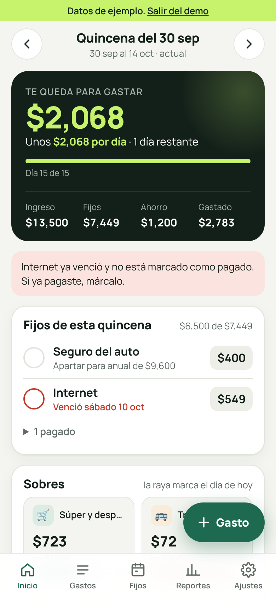
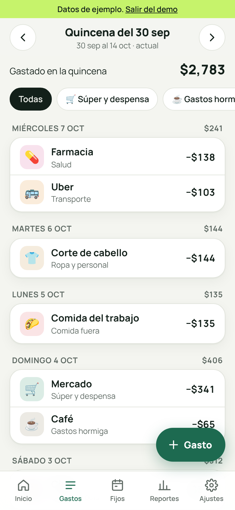
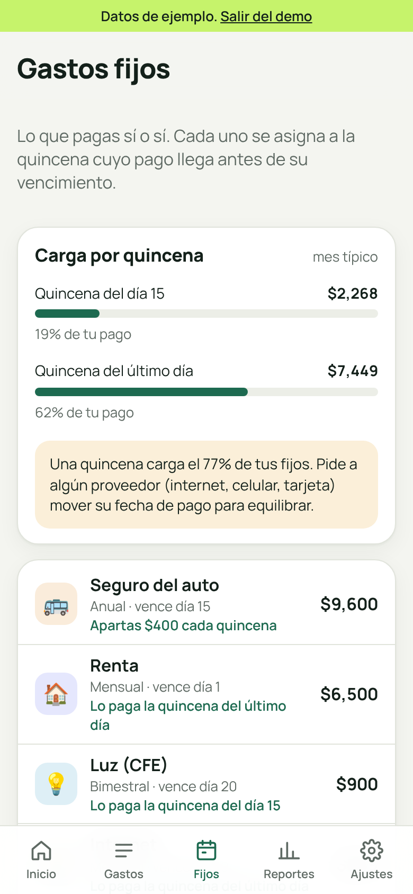
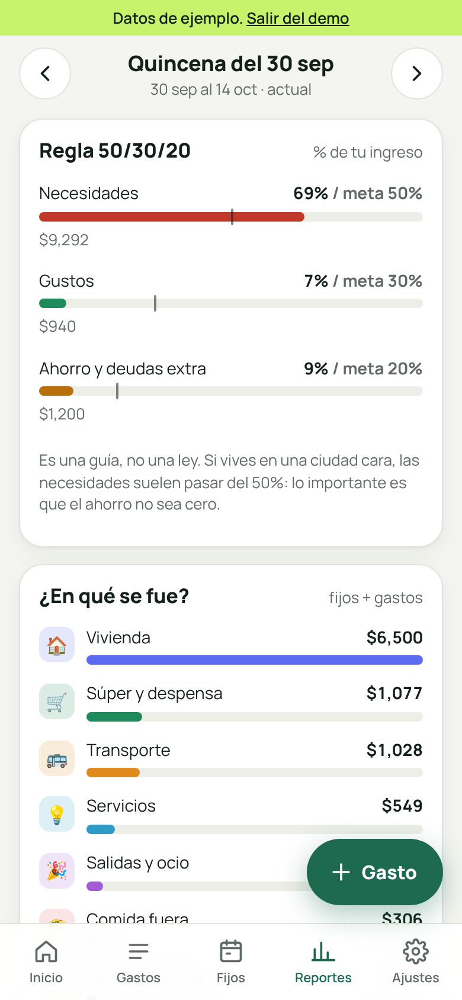
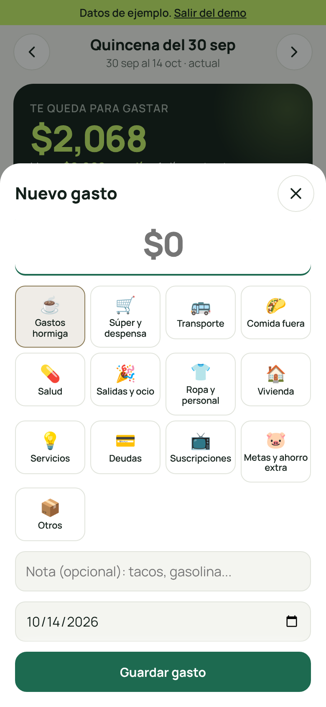

# Quincena

App web (instalable en el teléfono) para llevar tus finanzas por **quincena**: tu salario, tus gastos fijos, sobres por categoría y ahorro. Sin cuentas, sin servidor y sin conectar tu banco: los datos viven en tu dispositivo.



## Qué resuelve

La pregunta diaria: **"¿cuánto me queda para gastar hasta que me vuelvan a pagar?"**

- **Te queda para gastar** = ingreso de la quincena, menos ahorro, menos los gastos fijos que le tocan, menos lo que ya gastaste. Y cuánto te toca **por día** con los días que faltan.
- **Gastos fijos asignados a la quincena correcta.** Si te pagan el 15 y el último día, una renta que vence el día 1 sale del pago del último día del mes anterior (no del 15, como dicen muchas guías).
- **Sobres por categoría** (súper, transporte, salidas, gastos hormiga...) con una raya que marca qué tan avanzada va la quincena, para ver si vas rápido.
- **Gastos no mensuales** (luz bimestral, seguro anual, predial): puedes **apartar** una parte cada quincena.
- **Reportes:** regla 50/30/20 real contra meta, en qué se fue el dinero, gastos hormiga proyectados al año y tendencia de las últimas 6 quincenas.

## Pantallas

| Inicio | Gastos | Fijos | Reportes | Nuevo gasto |
| --- | --- | --- | --- | --- |
|  |  |  |  |  |

Hay versión en modo oscuro de cada una en `design/screens/`.

## Cómo usarla

1. **Bienvenida (1 minuto):** cuánto recibes neto por quincena, qué días te pagan, si te adelantan el pago cuando cae en fin de semana, cuánto quieres ahorrar y tu moneda.
2. **Fijos:** agrega renta, luz, internet, celular, etc. Toca una sugerencia para hacerlo más rápido. Indica frecuencia y día de vencimiento.
3. **Sobres:** en Ajustes, ponle un monto por quincena a las categorías que quieras limitar.
4. **Día a día:** botón **+ Gasto**, escribe el monto, toca la categoría, guarda. Marca los fijos como pagados cuando los pagues (puedes anotar el monto real si varió).

Para probar sin capturar nada: abre la app con `?demo=1` (usa datos separados de los tuyos).

## Ponerla en tu teléfono

La app es estática (HTML, CSS y JavaScript sin dependencias), así que se puede publicar gratis con **GitHub Pages**:

1. En GitHub: **Settings → Pages → Build and deployment → Deploy from a branch**, elige la rama y la carpeta `/ (root)`.
2. Abre la URL que te da GitHub en el teléfono.
3. **Android (Chrome):** menú ⋮ → *Instalar app*. **iPhone (Safari):** Compartir → *Agregar a pantalla de inicio*.

Funciona sin internet después de la primera visita.

## Tus datos

- Se guardan en el almacenamiento local del navegador. No salen del dispositivo.
- **Haz respaldo:** Ajustes → *Exportar respaldo* (JSON). Para moverte de teléfono, importa ese archivo en el nuevo.
- *Exportar CSV* para abrir tus movimientos en Excel o Google Sheets.

## Limitaciones conocidas

- No se conecta al banco: depende de que registres tus gastos. Si dejas de capturar, deja de servir.
- No sincroniza entre dispositivos (usa el respaldo).
- Las compras con tarjeta de crédito cuentan en la quincena en que las haces, no en la fecha de corte.

## Desarrollo

```bash
npm test     # pruebas de la lógica de quincenas (node --test, sin dependencias)
npm start    # servidor local en http://localhost:8080
```

| Archivo | Contenido |
| --- | --- |
| `src/logic.js` | Lógica pura: quincenas, asignación de fijos, resumen, montos. Probada en `tests/`. |
| `src/store.js` | Persistencia local, validación de respaldos, datos de ejemplo. |
| `src/app.js` | Interfaz (pantallas, hojas, eventos). |
| `src/styles.css` | Estilos y tokens de diseño (claro y oscuro). |
| `sw.js`, `manifest.webmanifest` | Funcionamiento sin conexión e instalación. |
| `design/` | Tokens para Figma, capturas y guía de importación. |
| `docs/investigacion.md` | Apps de referencia, Reddit y foros, método quincenal y decisiones. |
